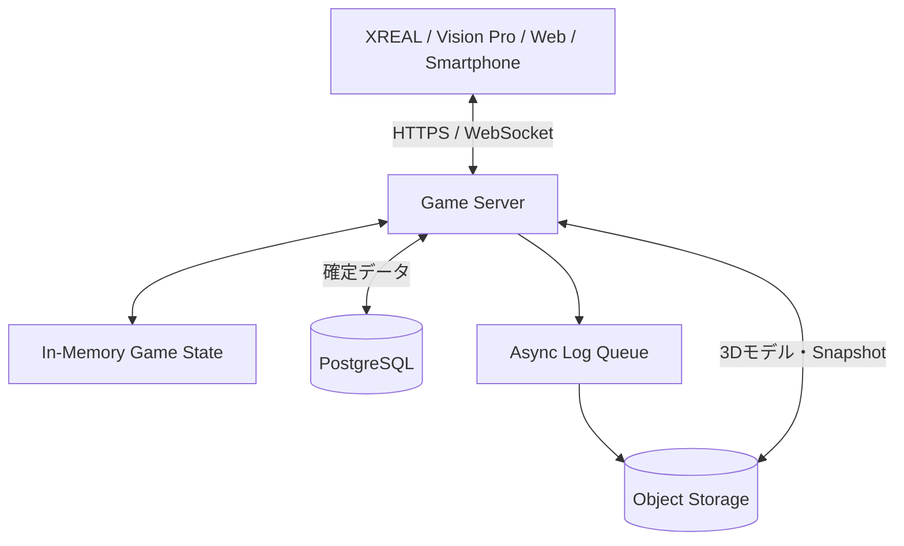
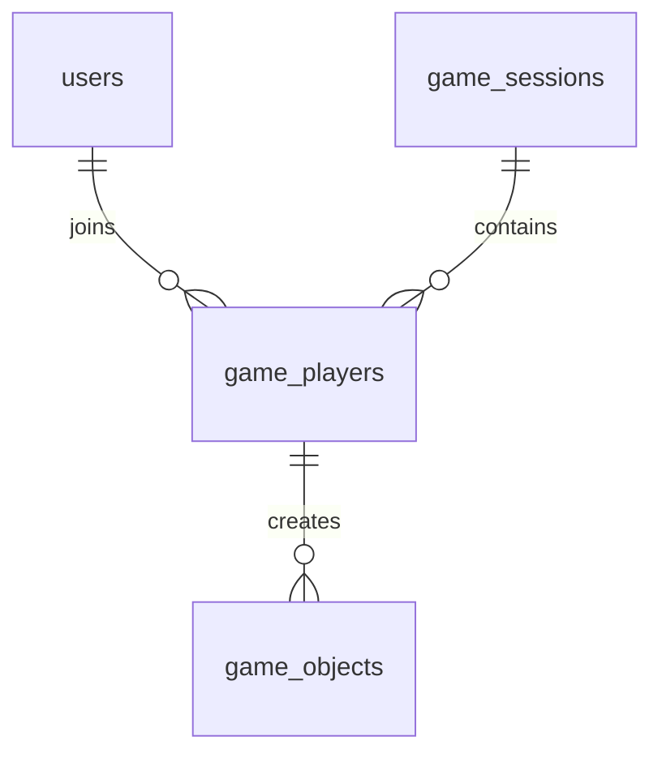
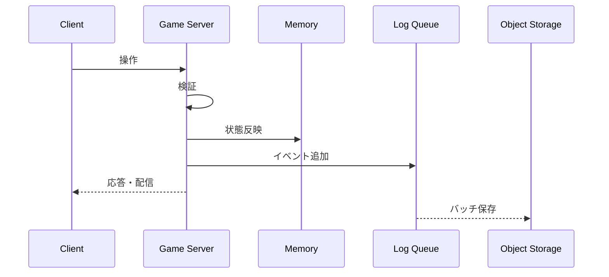

# めっちゃ美唄 — 統合仕様書

**Version:** 1.0-MVP  
**Status:** Draft  
**対象:** Web / XREAL / Apple Vision Pro / スマートフォン  
**構成:** PostgreSQL + 単一Game Server（メモリ）+ WebSocket + Object Storage  
**方針:** 最小構成で動作させ、ネイティブアプリへ拡張できるAPI契約を保つ。

## 1. ゲーム概要

美唄をテーマとした3Dマップで遊ぶ、非対称型XRかくれんぼゲーム。

- **ドロ（`hider`）**: XR上でオブジェクトをスカルプト・着色し、マップに配置して擬態する。
- **ケイ（`seeker`）**: スマホなどでマップを探索し、ドロが擬態したオブジェクトを見つける。
- **準備期間（`preparing`）**: ドロは制作・配置・擬態できる。ケイには配置情報を公開しない。
- **本番（`playing`）**: ケイが探索する。ドロは移動・再彫刻・再配置・再擬態できる。
- **終了（`finished`）**: 捕獲・時間切れなどでラウンド終了。次ラウンドでは役割変更可能。

| 項目 | MVP |
|---|---|
| 人数 | 2人を基本とする（データ構造は複数人対応） |
| ドロ側 | XREAL / Vision Pro（スマホは追加候補） |
| ケイ側 | スマホ（XREAL / Vision Proは追加候補） |
| マップ | 共有された3Dマップ。端末固有のAR座標から変換する |
| 彫刻同期 | MVPは完成したメッシュをアップロードして反映 |
| 捕獲 | ケイが対象オブジェクトを選択し、サーバーが判定 |
| スコア | サーバー管理。具体的な配点はゲームルール実装時に確定 |
| 制限時間 | サーバーの`phase_ends_at`で管理。長さはラウンド開始時に指定 |

**MVPの割り切り:** 最小体積、同一オブジェクト追加時のコスト倍増、アイテム報酬（Reward Set）は今後のルール候補であり、DBにはまだ組み込まない。

## 2. アーキテクチャ



- **REST**: 認証、セッション参加、フェーズ切替、アセット確定、捕獲など。
- **WebSocket**: Transform（位置・回転・スケール）、ゲームイベント、再接続時の状態同期。
- **サーバーメモリ**: ゲーム中の最新Transform、プレイヤーPose、接続状態、一時編集状態。
- **PostgreSQL**: ユーザー、ゲーム、参加者、確定したオブジェクト。
- **Object Storage**: GLB、テクスチャ、ログ、Snapshot。
- **RedisはMVPでは使わない。** Game Serverは単一インスタンスを前提とする。

## 3. データベース（4テーブル）



| Table | 主なフィールド | 責務 |
|---|---|---|
| `users` | `id`, `name`, `created_at` | ユーザー |
| `game_sessions` | `id`, `host_user_id`, `status`, `round`, `map_id`, `phase_ends_at`, `created_at` | ゲーム全体と現在のラウンド |
| `game_players` | `id`, `session_id`, `user_id`, `role`, `score`, `is_caught`, `created_at` | 参加者の役割・現在状態 |
| `game_objects` | `id`, `player_id`, `round`, `asset_url`, `transform`, `is_disguise`, `created_at`, `updated_at` | 彫刻したオブジェクトと配置 |

`host_user_id` はホスト権限を明確にするための列。初回は `round = 1`。`finished` は「現在のラウンドが終了した状態」であり、次の `preparing` へ遷移できる。

### 3.1 PostgreSQL DDL（実装例）

```sql
CREATE TABLE users (
  id UUID PRIMARY KEY DEFAULT gen_random_uuid(),
  name TEXT NOT NULL,
  created_at TIMESTAMPTZ NOT NULL DEFAULT now()
);

CREATE TABLE game_sessions (
  id UUID PRIMARY KEY DEFAULT gen_random_uuid(),
  host_user_id UUID NOT NULL REFERENCES users(id),
  status TEXT NOT NULL DEFAULT 'waiting'
    CHECK (status IN ('waiting', 'preparing', 'playing', 'finished')),
  round INTEGER NOT NULL DEFAULT 1 CHECK (round >= 1),
  map_id TEXT NOT NULL,
  phase_ends_at TIMESTAMPTZ,
  created_at TIMESTAMPTZ NOT NULL DEFAULT now()
);

CREATE TABLE game_players (
  id UUID PRIMARY KEY DEFAULT gen_random_uuid(),
  session_id UUID NOT NULL REFERENCES game_sessions(id) ON DELETE CASCADE,
  user_id UUID NOT NULL REFERENCES users(id),
  role TEXT CHECK (role IN ('hider', 'seeker')),
  score INTEGER NOT NULL DEFAULT 0,
  is_caught BOOLEAN NOT NULL DEFAULT false,
  created_at TIMESTAMPTZ NOT NULL DEFAULT now(),
  UNIQUE (session_id, user_id)
);

CREATE TABLE game_objects (
  id UUID PRIMARY KEY DEFAULT gen_random_uuid(),
  player_id UUID NOT NULL REFERENCES game_players(id) ON DELETE CASCADE,
  round INTEGER NOT NULL CHECK (round >= 1),
  asset_url TEXT NOT NULL,
  transform JSONB NOT NULL,
  is_disguise BOOLEAN NOT NULL DEFAULT false,
  created_at TIMESTAMPTZ NOT NULL DEFAULT now(),
  updated_at TIMESTAMPTZ NOT NULL DEFAULT now()
);

CREATE UNIQUE INDEX one_disguise_per_player_round
  ON game_objects(player_id, round) WHERE is_disguise = true;

CREATE INDEX idx_game_players_session ON game_players(session_id);
CREATE INDEX idx_game_objects_player_round ON game_objects(player_id, round);
```

- 全IDはUUIDv4として生成する（上記の `gen_random_uuid()` を利用）。
- `role` はラウンド開始時に**上書き**する。過去の役割やラウンド別得点はDBに保持しない。
- `score` はセッション内の累計得点。`is_caught` はラウンドごとにリセット。
- `game_objects.round` により以前のラウンドのオブジェクトを除外できる。
- `asset_url` には **期限付き署名URLではなく永続的なストレージ参照URI/キー** を保存する。
- `updated_at` は更新API側で設定する。
- 所有者・ラウンド一致・フェーズ権限はサーバーで検証する。

### 3.2 Transform

```ts
type Transform = {
  position: [number, number, number]; // メートル (x, y, z)
  rotation: [number, number, number, number]; // Quaternion (x, y, z, w)
  scale: [number, number, number]; // x, y, z
};
```

共有マップ座標系を**右手系・Y-up・メートル単位**で統一し、Quaternionは正規化する。端末のARローカル座標と共有マップ座標の変換はクライアント側で実施する。

## 4. ゲーム状態とルール

```text
waiting → preparing → playing → finished → preparing（次ラウンド）
```

| 状態 | ドロ | ケイ |
|---|---|---|
| `waiting` | 参加・待機 | 参加・待機 |
| `preparing` | 彫刻・配置・擬態 | 待機（隠し場所は見せない） |
| `playing` | 移動・再彫刻・再配置・再擬態 | 探索・捕獲 |
| `finished` | 結果確認 | 結果確認 |

- `waiting → preparing` の初回はRound 1。`finished → preparing` の際に `round++`。
- ラウンド開始時に役割を再割当てし、`is_caught = false` にする。スコアは維持。
- ゲームのタイマーはサーバー時刻を正とし、期限到来で自動遷移できる。
- 1人のドロが同時に擬態するオブジェクトは最大1つ。切替はサーバーで原子的に実施。
- 捕獲されたドロは当該ラウンドで以降の編集・移動をできない。
- 全ドロの捕獲、または制限時間到来でラウンド終了。点数・勝敗の細則は後から調整する。

## 5. REST API

**Base URL:** `https://{host}/v1`  
**認証:** `Authorization: Bearer <accessToken>`（ゲスト登録時に発行する署名付きトークン）  
**データ形式:** JSON（時刻はUTC ISO 8601、IDはUUID文字列）

| Method | Endpoint | 内容 | 権限 |
|---|---|---|---|
| POST | `/guests` | ゲスト作成、Token発行 | 公開 |
| POST | `/sessions` | セッション作成（作成者は自動参加） | 認証ユーザー |
| POST | `/sessions/{id}/join` | セッションに参加（再実行可） | 認証ユーザー |
| GET | `/sessions/{id}` | 参加者とゲーム基本情報を取得 | 参加者 |
| GET | `/sessions/{id}/state` | 権限に応じた最新Snapshotを取得 | 参加者 |
| POST | `/sessions/{id}/rounds/start` | 準備開始・役割設定 | ホスト |
| POST | `/sessions/{id}/rounds/play` | 本番開始（期限切れ時はサーバーも実行） | ホスト |
| POST | `/sessions/{id}/rounds/finish` | ラウンド終了 | ホスト |
| POST | `/assets/uploads` | 3Dアセットのアップロード用署名URLを取得 | 参加者 |
| POST | `/sessions/{id}/objects` | オブジェクト登録 | ドロ |
| PATCH | `/sessions/{id}/objects/{objectId}` | 確定メッシュ/Transformを更新 | 所有ドロ |
| DELETE | `/sessions/{id}/objects/{objectId}` | オブジェクト削除 | 所有ドロ |
| POST | `/sessions/{id}/objects/{objectId}/disguise` | 擬態先を切り替え | 所有ドロ |
| POST | `/sessions/{id}/captures` | 捕獲判定 | ケイ |
| GET | `/maps/{mapId}` | マップ定義を取得 | 参加者 |

### 5.1 主要なRequest / Response

**ゲスト作成**

```http
POST /v1/guests
Content-Type: application/json

{"name":"Player1"}
```

```json
{"user":{"id":"<uuid>","name":"Player1"},"accessToken":"<token>"}
```

**セッション作成・参加**

```http
POST /v1/sessions
Authorization: Bearer <token>
Content-Type: application/json

{"mapId":"bibai-museum"}
```

```json
{"id":"<session-id>","status":"waiting","round":1,"mapId":"bibai-museum"}
```

`POST /sessions/{id}/join` は同一ユーザーの再参加時に既存の `playerId` を返す。

**準備開始**

```http
POST /v1/sessions/{id}/rounds/start

{"preparingSeconds":120,"roles":[{"playerId":"<p1>","role":"hider"},{"playerId":"<p2>","role":"seeker"}]}
```

**本番開始**

```http
POST /v1/sessions/{id}/rounds/play

{"playingSeconds":180}
```

**アセット登録**

```http
POST /v1/assets/uploads

{"sessionId":"<session-id>","contentType":"model/gltf-binary","sizeBytes":204800}
```

```json
{"assetKey":"sessions/<session-id>/assets/<asset-id>.glb","uploadUrl":"https://storage.example.com/<signed-url>"}
```

クライアントは署名付きURLへ直接アップロードし、その後にオブジェクトを登録する。サーバーはアップロード済み・所有者・サイズ・形式を確認する。過去のアセットは上書きせず新規キーを発行する。

**オブジェクト作成**

```http
POST /v1/sessions/{id}/objects

{"assetKey":"sessions/<session-id>/assets/<asset-id>.glb","transform":{"position":[0,0,0],"rotation":[0,0,0,1],"scale":[1,1,1]}}
```

```json
{"id":"<object-id>","round":1}
```

`PATCH /objects/{objectId}` は `assetKey` または `transform` の部分更新を許可する。`disguise` は対象へ擬態し、以前の擬態先を解除する。捕獲APIは `{"objectId":"<object-id>"}` を受け取り、`{"result":"caught" | "miss", "scoreDelta":0}` 形式で返す。得点はルールに従いサーバーが計算する。

### 5.2 RESTの原則

- フェーズ変更、捕獲、得点確定はDBトランザクション後に成功応答する。
- 重複リクエストでラウンドを二重に開始しない。競合時は `409 Conflict`。
- `game_objects` の位置確定は、ドラッグ終了時などに `PATCH` でDBへ反映する。
- サーバーが内部で管理する `is_disguise` を探索側のレスポンスに含めない。
- RESTの状態取得はWebSocket Snapshotと同じ公開範囲ルールを適用する。

## 6. WebSocket API

**Endpoint:** `wss://{host}/v1/ws`  
接続後に `auth` メッセージでTokenとセッションIDを送る。認証成功時に `session.snapshot` を送信する。

```json
{"type":"auth","payload":{"accessToken":"<token>","sessionId":"<session-id>"}}
```

### 6.1 共通形式

```ts
type WSMessage<T = unknown> = {
  type: string;
  payload: T;
  round?: number;  // サーバー配信メッセージに付与
  seq?: number;    // サーバー配信メッセージに付与
  timestamp?: number; // Unix ms、サーバー時刻
};
```

`seq` は**ラウンド内のサーバー確定順序**。ラウンドが変わった場合は `(round, seq)` で区別する。クライアントの `clientSeq` は送信者側の重複・逆順検出専用で、サーバーの `seq` と別物。

| Event | 方向 | 内容 |
|---|---|---|
| `session.snapshot` | S → C | 参加者に公開可能な最新状態一式 |
| `session.phase_changed` | S → C | 現在フェーズ・期限・ラウンド |
| `player.transform` | C → S → 許可されたC | プレイヤー位置・向き |
| `object.transform` | C → S → 許可されたC | オブジェクト位置・回転・スケール |
| `object.created` | S → C | オブジェクト生成 |
| `object.updated` | S → C | 確定アセット/Transform変更 |
| `object.deleted` | S → C | オブジェクト削除 |
| `player.caught` | S → C | 捕獲結果通知 |
| `command.ack` | S → C | 必要な操作のACK |
| `error` | S → C | エラー通知 |

**Transform送信例（C → S）**

```json
{"type":"object.transform","payload":{"objectId":"<object-id>","clientSeq":10,"transform":{"position":[1,0,2],"rotation":[0,0.7071,0,0.7071],"scale":[1,1,1]}}}
```

**Transform配信例（S → C）**

```json
{"type":"object.transform","round":1,"seq":42,"timestamp":1795356000000,"payload":{"objectId":"<object-id>","transform":{"position":[1,0,2],"rotation":[0,0.7071,0,0.7071],"scale":[1,1,1]}}}
```

### 6.2 同期ルール

1. 操作の所有権・フェーズ・Transformの値域・`clientSeq` をサーバーで検証。
2. サーバーメモリに反映し、許可されたクライアントへ配信。
3. 通常の高頻度更新はDBを待たず、イベントをメモリのログキューに追加して非同期保存。
4. クライアントは受信したTransformを補間して描画する（目安10〜20Hz配信、描画は端末FPS）。
5. `preparing` 中、ケイにはオブジェクト配置・擬態情報を送らない。
6. `playing` 中、ケイへ公開するオブジェクト情報には `is_disguise`、ドロの非公開Pose、作成者など正解に直結する属性を含めない。
7. ドロの位置は原則ケイへ送らない。公開される擬態オブジェクトのTransformは通常のオブジェクトと同様に同期する。
8. スカルプトの**ブラシの連続操作**はMVPでは同期しない。確定したGLBの更新を `object.updated` で知らせる。
9. 再接続時は `session.snapshot`（または `GET /state`）を取得し、未確定の古い更新を破棄する。

### 6.3 最新状態のメモリ表現

```ts
type GameState = {
  sessionId: string;
  round: number;
  status: "waiting" | "preparing" | "playing" | "finished";
  phaseEndsAt: string | null;
  players: Map<string, { transform?: Transform; connected: boolean }>;
  objects: Map<string, { playerId: string; transform: Transform; assetUrl: string; isDisguise: boolean }>;
  seq: number;
};

const sessions = new Map<string, GameState>();
```

`playerId` や `isDisguise` は**サーバー内部情報**であり、クライアント送信時に公開用DTOに変換する。

## 7. 非同期ログとリプレイ



### 7.1 ログ形式（JSONL）

```json
{"sessionId":"<session-id>","round":1,"seq":42,"timestamp":1795356000000,"playerId":"<player-id>","type":"object.transform","payload":{"objectId":"<object-id>","transform":{"position":[1,0,2],"rotation":[0,0,0,1],"scale":[1,1,1]}}}
```

- 記録イベント: オブジェクト生成・削除・アセット確定更新・Transform（一部間引き）・捕獲・スコア・役割設定・フェーズ変更。
- ログはラウンド別に分割して保存する（例: `sessions/{sessionId}/rounds/{round}/events/{firstSeq}-{lastSeq}.jsonl`）。
- Snapshotは初期状態・一定時間ごと（例:30秒）・終了時に保存する。
- リプレイは直前Snapshotを読み込み、`seq` 順にイベントを適用する。
- GLBの古いバージョンを消さない。アセットは変更ごとに新しいキーで保存する。
- 非同期ログ未Flush分はクラッシュ時に失われ得るため、**完全再現はMVPでは保証しない**。
- `is_disguise` 等を含む**内部Snapshot/ログは非公開**とし、ゲーム終了後の認可済みリプレイに限り公開する。

### 7.2 永続化タイミング

| 操作 | 確定先 | タイミング |
|---|---|---|
| ユーザー・参加・役割・フェーズ | PostgreSQL | 操作確定時 |
| 高頻度Transform / Pose | サーバーメモリ | 受信時 |
| Transformの最終配置 | PostgreSQL | 配置・移動確定時 |
| 彫刻されたGLB | Object Storage | アップロード・確認後 |
| アセット参照の変更 | PostgreSQL | 編集確定時 |
| 捕獲・スコア | PostgreSQL | 判定確定時 |
| イベントログ | Object Storage | 非同期バッチ |
| Snapshot | Object Storage | 定期・ラウンド終了時 |

## 8. クライアント構成・ネイティブ対応

- **共通契約**: RESTはOpenAPI、WSメッセージはJSON Schemaで型を定義する。
- **Web**: ブラウザ2台でルーム参加・キューブTransform同期・捕獲までを先行検証。
- **XREAL**: 対応ハードウェアのSDK要件に応じてXRトラッキング・描画を実装。
- **visionOS**: Swift + RealityKit / Metal等で描画・入力・Transform変換を実装。
- **スマートフォン**: まずWebを優先し、必要ならネイティブ化する。
- **全端末共通**: サーバーAPIはデバイス依存型を持たず、各端末は座標Adapterでマップ空間に変換する。

## 9. エラー・運用上の制約

```json
{"error":{"code":"INVALID_GAME_PHASE","message":"This action is not allowed in the current phase."}}
```

| HTTP | 用途 |
|---|---|
| 400 | 不正な入力 |
| 401 | 未認証 |
| 403 | 権限不足 |
| 404 | 対象なし |
| 409 | フェーズ・状態の競合 |
| 429 | 操作頻度制限 |
| 500 | サーバーエラー |

- WebSocket・RESTの両方で本人確認とオブジェクト所有権を検証する。
- 捕獲の総当たりを防ぐため、捕獲APIはレート制限・連打防止を設ける。
- 署名付きアップロードURLには短い期限とサイズ上限を設ける。
- セッションは単一プロセスに保持。**プロセス再起動中のラウンド継続はMVPでは保証しない。** DBに残る確定状態は復元可能だが、未保存Transform・ログは失われる。
- 複数プロセスへ水平分散する際にRedisや共有イベント基盤の導入を検討する。

## 10. 実装順序

1. **Contracts**: OpenAPIとWS JSON Schema、Transform座標系を確定。
2. **Backend基盤**: 4テーブル、ゲスト認証、ルーム作成・参加、ホスト権限。
3. **同期検証**: ブラウザ2台でWebSocket、Snapshot、Transform・回転・スケール同期。
4. **ゲームループ**: 準備、本番、捕獲、制限時間、役割交代。
5. **3D制作**: GLBアップロード、オブジェクト配置、擬態切替、編集中の変更確定。
6. **ログ**: 非同期JSONL、Snapshot、簡易リプレイ。
7. **XRクライアント**: XREAL / visionOS、端末ごとの座標合わせとUI。

## 11. MVP対象外

- Redis / 複数Game Server間の同期
- ラウンド履歴専用DBテーブル
- 完全なスカルプト筆跡同期・物理シミュレーション
- 欠損ゼロを保証するリプレイ
- Reward Set・アイテム経済
- 彫刻ライブラリの永続的な再利用
- 精密なAR空間位置によるチート対策

---

**基本原則:** **ゲームの確定状態はPostgreSQL、動く状態はサーバーメモリ、通信はWebSocket、重いアセットとログはObject Storage。**
