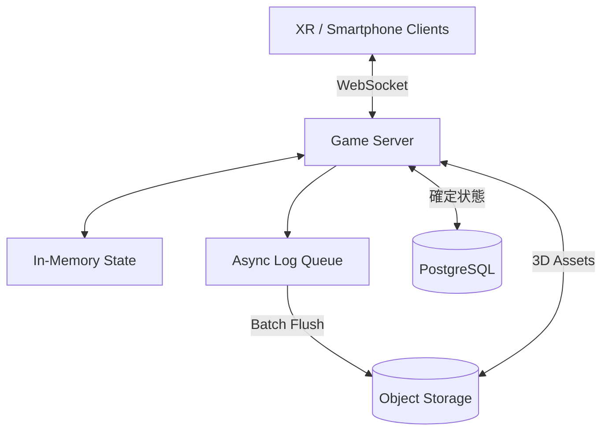
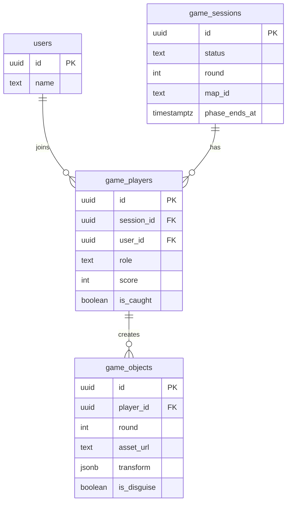
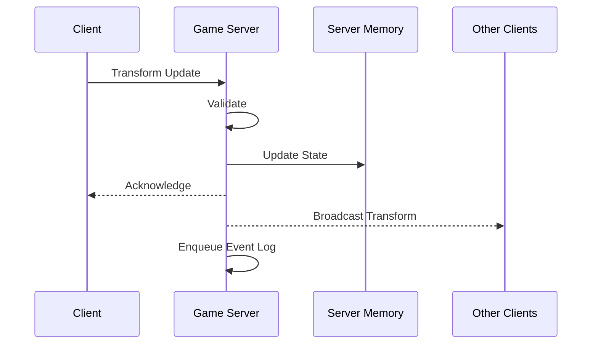

# めっちゃ美唄 — Database & Realtime Specification

**Version:** 0.3 (MVP)  
**Database:** PostgreSQL  
**Realtime:** WebSocket + Server Memory  
**Storage:** Object Storage  
**Cache:** Redis不使用

## 1. 概要

XRを用いた非対称型かくれんぼゲーム「めっちゃ美唄」のデータ管理・リアルタイム同期仕様。

### ゲームの流れ

**準備期間（preparing）**
- ドロ（隠れる側）は3Dオブジェクトをスカルプト・着色する。
- 作成したオブジェクトをマップ内に配置し、擬態して隠れる。
- ケイ（探す側）は待機する。

**本番（playing）**
- ドロは移動・再彫刻・再配置・再擬態が可能。
- ケイはマップ内を探索してドロを発見する。
- ゲーム終了後は役割を変更して次のラウンドを開始できる。

### 対応端末

| Role | Device |
|---|---|
| Hider | XREAL / Apple Vision Pro / Smartphone（予定） |
| Seeker | Smartphone / XREAL・Vision Pro（予定） |

端末種別はゲーム上の役割と独立する。

---

## 2. アーキテクチャ



### 責務

| Component | Responsibility |
|---|---|
| PostgreSQL | ユーザー、セッション、参加者、確定済みオブジェクト |
| Server Memory | 現在の座標・Transform・ゲーム状態 |
| WebSocket | クライアント間のリアルタイム同期 |
| Async Log Queue | イベントの一時蓄積 |
| Object Storage | 3Dモデル、テクスチャ、イベントログ、Snapshot |

RedisはMVPでは使用しない。

ゲーム状態の更新・検証はサーバーを正とする。

---

## 3. Database Schema

### 3.1 ER Diagram



### 3.2 `users`

ユーザーの基本情報。

| Column | Type | Description |
|---|---|---|
| id | UUID PK | ユーザーID |
| name | TEXT | 表示名 |
| created_at | TIMESTAMPTZ | 作成日時 |

### 3.3 `game_sessions`

ゲームセッションと現在のラウンドを管理する。

| Column | Type | Description |
|---|---|---|
| id | UUID PK | セッションID |
| status | TEXT | 現在のゲーム状態 |
| round | INTEGER | ラウンド番号、初期値1 |
| map_id | TEXT | マップ識別子 |
| phase_ends_at | TIMESTAMPTZ | 現フェーズの終了予定時刻 |
| created_at | TIMESTAMPTZ | 作成日時 |

**status**

```ts
type GameStatus =
  | "waiting"
  | "preparing"
  | "playing"
  | "finished";
```

`finished` は現在のラウンドが終了した状態を表す。次ラウンドを開始しない場合は、そのままセッションを終了扱いとする。

### 3.4 `game_players`

セッションとユーザーを結ぶ中間テーブル。

現在のラウンドにおける役割とプレイヤー状態を管理する。

| Column | Type | Description |
|---|---|---|
| id | UUID PK | 参加者ID |
| session_id | UUID FK | セッションID |
| user_id | UUID FK | ユーザーID |
| role | TEXT NULL | hider / seeker |
| score | INTEGER | 累計スコア、初期値0 |
| is_caught | BOOLEAN | 捕獲状態、初期値false |
| created_at | TIMESTAMPTZ | 参加日時 |

**Constraints**

- `UNIQUE(session_id, user_id)`
- `role IN ('hider', 'seeker')` または `NULL`

`role` はラウンド開始時に更新する。

過去ラウンドの役割履歴はDBでは保持しない。

### 3.5 `game_objects`

スカルプトされたオブジェクトと、その配置情報を管理する。

| Column | Type | Description |
|---|---|---|
| id | UUID PK | オブジェクトID |
| player_id | UUID FK | 作成したgame_players.id |
| round | INTEGER | 所属ラウンド |
| asset_url | TEXT | 3Dアセットの永続参照先 |
| transform | JSONB | 位置・回転・スケール |
| is_disguise | BOOLEAN | 現在擬態中のオブジェクトか |
| created_at | TIMESTAMPTZ | 作成日時 |
| updated_at | TIMESTAMPTZ | 更新日時 |

**Constraints**

- 1プレイヤーにつき、同一ラウンドで `is_disguise = true` は最大1件
- オブジェクト作成は現在のラウンドに所属する `hider` のみ
- `asset_url` は期限付きURLではなく、永続的なストレージキーまたは参照URIを使用する
- 編集済みアセットはバージョン別のキーで保存し、過去のリプレイに必要なファイルを上書きしない

**Transform**

```ts
type Transform = {
  position: [number, number, number];
  rotation: [number, number, number, number];
  scale: [number, number, number];
};
```

- position: 位置（x, y, z）
- rotation: Quaternion（x, y, z, w）
- scale: スケール（x, y, z）

座標系は共有マップのローカル座標系に統一する。

基準は右手系、Y軸上方向、長さの単位はメートルとする。

---

## 4. Realtime State

### 4.1 基本方針

**リアルタイム状態はサーバーメモリで管理する。**

以下の情報は、通常の更新ごとにPostgreSQLへ書き込まない。

- プレイヤーの位置・向き
- オブジェクトの位置・回転・スケール
- HMDのPose
- スカルプト編集中の状態
- クライアントの接続状態

ただし、ゲーム進行・捕獲・得点・確定したオブジェクトの状態はPostgreSQLに保存する。

### 4.2 メモリ構造

```ts
type GameState = {
  sessionId: string;
  round: number;
  status: GameStatus;

  players: Map<string, PlayerState>;
  objects: Map<string, ObjectState>;

  sequence: number;
};

type PlayerState = {
  playerId: string;
  transform?: Transform;
  connected: boolean;
};

type ObjectState = {
  id: string;
  playerId: string;
  transform: Transform;
  assetUrl: string;
  isDisguise: boolean;
};
```

セッションIDをキーとして管理する。

```ts
const sessions = new Map<string, GameState>();
```

各セッションの操作はサーバー側で順序を確定し、同じ状態への同時更新による競合を防ぐ。

### 4.3 Transform同期



**同期対象**

| Data | Realtime | Persistent |
|---|---|---|
| Object Position | Yes | 確定時 |
| Object Rotation | Yes | 確定時 |
| Object Scale | Yes | 確定時 |
| Player Transform | Yes | 原則No |
| HMD Pose | 必要時 | No |
| Sculpt Changes | Yes | 確定時 |
| Game Status | Yes | Yes |
| Score / Capture | Yes | Yes |

プレイヤーのPoseは端末が取得できる範囲で同期する。不要なHMDトラッキング情報は送信しない。

### 4.4 座標系

各端末のAR座標系は異なるため、共有マップ座標を基準とする。

```text
Device Local Space
       ↓
Map Local Space
       ↓
WebSocket Sync
       ↓
Map Local Space
       ↓
Other Device Local Space
```

座標・回転・スケールの変換はクライアント側で行う。

各端末が同じマップ原点・向きを共有するためのキャリブレーションは別途実装する。

### 4.5 同期頻度

MVPの初期目安：

- Transform: 10〜20Hz
- HMD Pose: 必要時のみ
- Sculpt: 編集差分を送信
- Game Events: 発生時に送信

受信側はTransformを補間して描画する。

更新頻度は実機の通信遅延・帯域・描画品質に合わせて調整する。

### 4.6 WebSocket Events

共通メッセージ形式：

```ts
type RealtimeMessage = {
  type: string;
  payload: unknown;
};
```

主なイベント：

| Event | Description |
|---|---|
| `player.transform` | プレイヤー位置・向き更新 |
| `object.created` | オブジェクト生成 |
| `object.transform` | Transform更新 |
| `object.updated` | 彫刻・アセット更新 |
| `object.deleted` | オブジェクト削除 |
| `player.caught` | 捕獲 |
| `game.phase_changed` | ゲーム状態変更 |
| `game.snapshot` | 最新状態の同期 |

**Transform更新例**

```json
{
  "type": "object.transform",
  "payload": {
    "objectId": "uuid",
    "transform": {
      "position": [1, 0, 2],
      "rotation": [0, 0, 0, 1],
      "scale": [1, 1, 1]
    },
    "sequence": 42
  }
}
```

`sequence` はサーバーが採番する状態更新番号とする。

古い更新が到着した場合は破棄する。

クライアントからの操作には必要に応じて別途リクエストIDを付け、サーバーで検証する。

`is_disguise` などの正解情報は、ケイに配信しない。

同様に、ドロの位置情報もゲームルールで許可されない限りケイへ公開しない。

---

## 5. Async Event Logging

### 5.1 基本方針

リアルタイム操作はメモリ上の状態を更新して先に応答し、ログは非同期で保存する。

```text
Client Event
    ↓
Server Validation
    ↓
In-Memory State Update
    ↓
Event Queueへ追加
    ↓
Client ACK / Broadcast
    ↓
Async Batch Flush
    ↓
Event Log Storage
```

ログ保存完了をリアルタイム操作の応答条件にはしない。

ただし、重要な確定操作はDBへの書き込み成功後に確定応答する。

### 5.2 Event Format

```ts
type GameEvent = {
  sessionId: string;
  round: number;
  seq: number;
  timestamp: number;
  playerId: string | null;
  type: string;
  payload: unknown;
};
```

- `seq`: セッション内の単調増加する連番
- `timestamp`: サーバー時刻（Unix milliseconds）
- `playerId`: 操作した参加者のID。システムイベントではnull
- `payload`: イベントに必要なデータ

**記録対象**

- オブジェクト生成・削除
- オブジェクトのTransform
- 確定したスカルプト変更とアセットのバージョン
- 必要なプレイヤー移動情報
- 捕獲
- 得点変更
- ラウンド・フェーズ変更

ログはJSONL形式で保存する。

Transformログは必要に応じて間引く。

### 5.3 Snapshot

一定間隔、またはラウンド終了時にGameStateのSnapshotを保存する。

Snapshotには以下を含める。

- sessionId
- round
- seq
- timestamp
- game status
- player states
- object states
- asset references

ログとSnapshotはObject Storageへ保存する。

初期実装では、30秒ごとのSnapshotを目安とする。

---

## 6. Replay

### 6.1 再生方式

Snapshot + Event Log方式を採用する。

```text
Snapshot
    ↓
Load Events
    ↓
Apply Events by Sequence
    ↓
Reconstruct Game State
    ↓
Render Replay
```

任意の再生時刻に対して、直前のSnapshotを読み込み、その後のイベントを適用する。

Transformはイベント間を補間して再生する。

### 6.2 リプレイの制約

- ログ取得頻度より細かな動きは補間による近似となる
- 3Dアセットはイベント当時のバージョンを使用する
- スカルプトの制作過程まで再現する場合は編集差分の記録が必要
- 非同期ログの未保存分はサーバークラッシュ時に失われる可能性がある
- MVPでは完全なリプレイ再現性を保証しない

---

## 7. Game Lifecycle

```text
waiting
   ↓
preparing
   ↓
playing
   ↓
finished
   ↓
preparing（次ラウンド）
```

### ラウンド開始

1. 必要に応じて `game_sessions.round` を加算する
2. `game_players.role` を割り当てる
3. `is_caught` をfalseにリセットする
4. `game_sessions.status` を `preparing` にする
5. `phase_ends_at` を設定する
6. 最新状態を全参加者へ通知する

ラウンド開始処理はDBトランザクションで実行する。

### 本番開始

1. `status` を `playing` に更新する
2. 本番終了予定時刻を設定する
3. 全参加者へ状態変更イベントを通知する

### ラウンド終了

1. 捕獲・時間切れなどの終了条件を確認する
2. スコアを確定・永続化する
3. `status` を `finished` に更新する
4. 残りのイベントログをFlushする
5. 最終Snapshotを保存する

ゲームの制限時間・判定・得点計算はサーバー側で管理する。

---

## 8. Persistence Policy

| Operation | Storage | Timing |
|---|---|---|
| ユーザー作成 | PostgreSQL | 即時 |
| セッション作成 | PostgreSQL | 即時 |
| 参加・役割変更 | PostgreSQL | 確定時 |
| ゲーム状態変更 | PostgreSQL | 確定時 |
| Transform更新 | Memory | 即時 |
| Sculpt編集中 | Memory | 即時 |
| Sculpt確定 | Object Storage + PostgreSQL | 確定時 |
| Object配置確定 | PostgreSQL | 確定時 |
| 捕獲・スコア確定 | PostgreSQL | 確定時 |
| Event Log | Object Storage | 非同期 |
| Snapshot | Object Storage | 定期・終了時 |

---

## 9. Reliability & Security

### サーバー再起動

- メモリ状態は失われる
- DBの確定状態から復元する
- 保存済みSnapshotとイベントログがあれば、そこから追加復元できる
- 未Flushログと未確定のTransform更新は失われる可能性がある
- MVPでは単一Game Serverを前提とする

### 操作検証

- 参加者の認証・認可をサーバーで行う
- 自分が所有するオブジェクトだけを編集できる
- ゲーム状態に応じて操作を制限する
- 捕獲や得点はサーバーで判定する
- 不正なTransform・アセット参照を拒否する
- 正解情報や非公開Poseは権限のないクライアントへ配信しない

### 同期・ログ

- 各セッションのイベント順序をサーバーで管理する
- 遅延した古いTransformを上書きしない
- 接続復帰時は最新Snapshotまたは状態を送信する
- 非同期ログキューの件数・容量を制限し、負荷時は高頻度Transformを間引く
- 重要なゲーム結果はログではなくPostgreSQLを正とする

---

## 10. MVP対象外

- Redis
- マルチサーバー間の状態同期
- ラウンド履歴専用テーブル
- 3Dモデルの再利用ライブラリ
- アイテム・Reward Set管理
- 完全なEvent Sourcing
- 完全再現を保証するリプレイ
- 複雑なリアルタイム競合解決

---

## 11. Design Principles

1. **Simple:** 永続DBは4テーブルに限定する。
2. **Realtime First:** 高頻度状態はサーバーメモリで扱う。
3. **Server Authoritative:** ゲーム判定はサーバーを正とする。
4. **Async Logging:** 通常のリアルタイム操作をログ保存でブロックしない。
5. **Replay Ready:** イベント順序・Snapshot・アセットバージョンを記録する。
6. **Extensible:** 将来的にRedis・複数サーバー構成へ移行できるよう責務を分離する。
